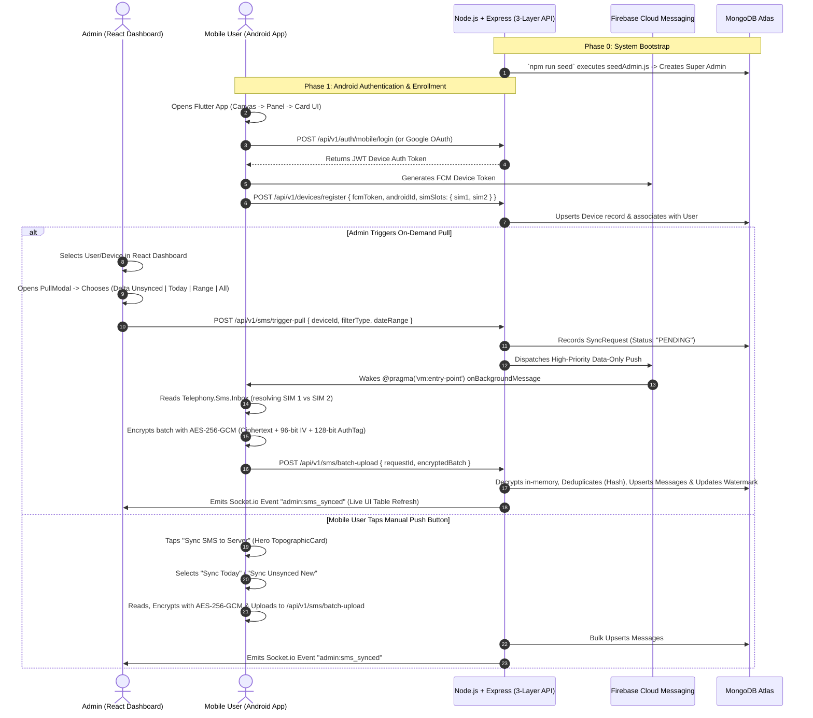

# End-to-End On-Demand SMS Sync System: Implementation Plan & Architecture Specification
### (EduTechLab Design System + Military-Grade AES-256-GCM Cryptographic Core)

> **Core Standards:**
> - **Cryptographic Standard:** **AES-256-GCM (Advanced Encryption Standard with a 256-bit key in Galois/Counter Mode)** — AEAD (Authenticated Encryption with Associated Data) preventing both eavesdropping and tampering.
> - **Visual Identity:** EduTechLab's **"Calm Organic Productivity"** — layered flat surfaces (*Canvas → Panel → Card*), pill controls, dark topographic contour surfaces, tabular rolling numbers, and smooth spring-based micro-interactions.
> - **Backend Pattern:** Strict 3-Layer Architecture (*Routes → Controllers → Services → Models*) with standardized `ApiError`, `ApiResponse`, Winston structured logging, and Joi validation.
> - **Silent Push Engine:** Firebase Cloud Messaging (FCM) High-Priority Data Messages with zero battery-draining continuous polling on mobile.

---

## 1. Military-Grade Cryptographic Architecture (AES-256-GCM)

```
┌─────────────────────────────────────────────────────────────────────────────────────────┐
│                        AES-256-GCM ENCRYPTION & AUTHENTICATION PIPELINE                 │
├─────────────────────────────────────────────────────────────────────────────────────────┤
│                                                                                         │
│  Plaintext SMS / Sensitive Payload                                                      │
│    │                                                                                    │
│    ├── 1. Cryptographically Secure IV: crypto.randomBytes(12) [96-bit unique nonce]    │
│    ├── 2. Key Derivation: 256-bit (32-byte) Key via HKDF-SHA256 from Master Secret     │
│    ├── 3. AAD Binding: Associated Data bound to DeviceId + UserId + Timestamp           │
│    │                                                                                    │
│    ▼                                                                                    │
│  [AES-256-GCM Cipher] ──► Produces Ciphertext + 128-bit (16-byte) Authentication Tag   │
│    │                                                                                    │
│    ▼                                                                                    │
│  Packed Armored Payload: { iv, ciphertext, authTag, aad, version: "aes-256-gcm-v1" }   │
│    │                                                                                    │
│    ├── Stored Encrypted at Rest in MongoDB Atlas (No plaintext ever touches the disk)  │
│    └── Transmitted over TLS 1.3 to Node.js Backend & React Dashboard                    │
│                                                                                         │
└─────────────────────────────────────────────────────────────────────────────────────────┘
```

### 1.1 Why AES-256-GCM is the Industry Gold Standard
1. **Confidentiality:** 256-bit key space ($2^{256}$ possibilities) is computationally unbreakable by brute force, quantum-resistant against conventional attacks.
2. **Authenticity & Integrity (AEAD):** In GCM (Galois/Counter Mode), encryption and authentication occur in tandem. It computes a 16-byte **Galois Message Authentication Code (GMAC)**. If even a single bit of the ciphertext, IV, or metadata is modified in transit or in the database, decryption immediately throws an authentication exception and aborts.
3. **No Padding Oracle Attacks:** Unlike CBC mode (`AES-256-CBC`) which requires PKCS#7 padding and is vulnerable to padding oracle attacks (e.g., POODLE), GCM is a stream cipher mode requiring zero padding.
4. **Context Binding via AAD (Additional Authenticated Data):** We bind the message to the target `deviceId` and `userId` as AAD. This guarantees that an encrypted payload belonging to Device A cannot be transplanted or replayed into Device B.

---

### 1.2 Production-Grade Node.js Cryptographic Implementation
File: `Web/backend/src/services/crypto.service.js`

```javascript
import crypto from 'node:crypto';
import ApiError from '../utils/apiError.js';

const ALGORITHM = 'aes-256-gcm';
const IV_LENGTH = 12; // 96-bit IV recommended by NIST SP 800-38D
const AUTH_TAG_LENGTH = 16; // 128-bit authentication tag

class CryptoService {
  constructor() {
    const secret = process.env.ENCRYPTION_MASTER_KEY;
    if (!secret || secret.length < 32) {
      throw new Error('ENCRYPTION_MASTER_KEY must be at least 32 characters long');
    }
    // Derive a fixed 32-byte key using HKDF to ensure high-entropy 256-bit key
    this.key = crypto.hkdfSync('sha256', secret, 'sms-transfer-salt', 'sms-payload-encryption', 32);
  }

  /**
   * Encrypts plaintext data using AES-256-GCM
   * @param {string|object} data - Data to encrypt
   * @param {string} [aad] - Additional Authenticated Data (e.g. `userId:deviceId`)
   * @returns {{ ciphertext: string, iv: string, authTag: string, aad?: string, v: string }}
   */
  encrypt(data, aad = null) {
    try {
      const plaintext = typeof data === 'object' ? JSON.stringify(data) : String(data);
      const iv = crypto.randomBytes(IV_LENGTH);
      const cipher = crypto.createCipheriv(ALGORITHM, this.key, iv, {
        authTagLength: AUTH_TAG_LENGTH
      });

      if (aad) {
        cipher.setAAD(Buffer.from(aad, 'utf8'));
      }

      let ciphertext = cipher.update(plaintext, 'utf8', 'base64');
      ciphertext += cipher.final('base64');
      const authTag = cipher.getAuthTag().toString('base64');

      return {
        ciphertext,
        iv: iv.toString('base64'),
        authTag,
        aad: aad || undefined,
        v: 'gcm-v1'
      };
    } catch (err) {
      throw ApiError.internal('Cryptographic encryption failure', [err.message]);
    }
  }

  /**
   * Decrypts and authenticates AES-256-GCM payload
   * @param {{ ciphertext: string, iv: string, authTag: string, aad?: string }} payload
   * @returns {string|object} Decrypted plaintext (or parsed JSON)
   */
  decrypt({ ciphertext, iv, authTag, aad = null }) {
    try {
      const ivBuffer = Buffer.from(iv, 'base64');
      const authTagBuffer = Buffer.from(authTag, 'base64');

      if (ivBuffer.length !== IV_LENGTH) {
        throw new Error('Invalid Initialization Vector length');
      }
      if (authTagBuffer.length !== AUTH_TAG_LENGTH) {
        throw new Error('Invalid Authentication Tag length');
      }

      const decipher = crypto.createDecipheriv(ALGORITHM, this.key, ivBuffer, {
        authTagLength: AUTH_TAG_LENGTH
      });

      if (aad) {
        decipher.setAAD(Buffer.from(aad, 'utf8'));
      }

      decipher.setAuthTag(authTagBuffer);

      let decrypted = decipher.update(ciphertext, 'base64', 'utf8');
      decrypted += decipher.final('utf8');

      try {
        return JSON.parse(decrypted);
      } catch {
        return decrypted;
      }
    } catch (err) {
      // Failed tag verification means data was corrupted or tampered with
      throw ApiError.unauthorized('Cryptographic integrity check failed. Message was tampered with.');
    }
  }

  /**
   * Generates a deterministic SHA-256 hash for deduplication
   */
  hashMessage(userId, sender, date, body) {
    return crypto
      .createHash('sha256')
      .update(`${userId}|${sender}|${date}|${body}`)
      .digest('hex');
  }
}

export default new CryptoService();
```

---

### 1.3 Matching Flutter / Dart Cryptographic Implementation
File: `Flutter/mobile_app/lib/services/crypto_service.dart`

```dart
import 'dart:convert';
import 'dart:typed_data';
import 'package:cryptography/cryptography.dart';

class CryptoService {
  static final _algorithm = AesGcm.with256bits(nonceLength: 12);
  static SecretKey? _cachedKey;

  static Future<void> initialize(String masterSecret) async {
    final hkdf = Hkdf(hmac: Hmac.sha256(), outputLength: 32);
    final secretKey = SecretKey(utf8.encode(masterSecret));
    final derivedKeyBytes = await hkdf.deriveKey(
      secretKey: secretKey,
      nonce: utf8.encode('sms-transfer-salt'),
      info: utf8.encode('sms-payload-encryption'),
    );
    _cachedKey = derivedKeyBytes;
  }

  /// Encrypts an SMS payload with AES-256-GCM matching Node.js
  static Future<Map<String, dynamic>> encryptPayload(
    dynamic data, {
    String? aad,
  }) async {
    if (_cachedKey == null) throw Exception('CryptoService not initialized');

    final jsonString = jsonEncode(data);
    final plaintextBytes = utf8.encode(jsonString);

    final secretBox = await _algorithm.encrypt(
      plaintextBytes,
      secretKey: _cachedKey!,
      aad: aad != null ? utf8.encode(aad) : const <int>[],
    );

    return {
      'ciphertext': base64Encode(secretBox.cipherText),
      'iv': base64Encode(secretBox.nonce),
      'authTag': base64Encode(secretBox.mac.bytes),
      'aad': aad,
      'v': 'gcm-v1',
    };
  }
}
```

---

## 2. EduTechLab Design System ("Calm Organic Productivity")

Both the **React Admin Dashboard** and the **Flutter Android App** follow the exact design tokens, typography, and motion specifications from `D:\TechGlora\Development\EduTechLab`:

### 2.1 The 3-Layer Neutral Surface Hierarchy

```
┌─────────────────────────────────────────────────────────────────────────────┐
│                     THE 3-LAYER SURFACE HIERARCHY                           │
├───────────────┬───────────┬─────────────────────────────────────────────────┤
│ Layer Token   │ Hex       │ Role & Application                              │
├───────────────┼───────────┼─────────────────────────────────────────────────┤
│ `--canvas`    │ `#E9EBE9` │ Outer window background behind floating panels  │
│ `--panel`     │ `#F5F6F5` │ Floating sidebar, header, and main content well │
│ `--card`      │ `#FDFDFC` │ Individual widgets, SMS rows, and stat cards    │
│ `--line`      │ `#ECEEEC` │ Hairline dividers and column borders            │
│ `--line-strong`│ `#DADDDB`│ Outlined inputs, search bars, and chip borders  │
├───────────────┼───────────┼─────────────────────────────────────────────────┤
│ `--ink`       │ `#111412` │ Primary headings, KPI figures, bold titles      │
│ `--ink-2`     │ `#3D4540` │ Body text, message contents                     │
│ `--muted`     │ `#737B76` │ Secondary timestamps, SIM labels, inactive nav  │
│ `--subtle`    │ `#9AA29D` │ Captions, table column headers, empty states    │
└───────────────┴───────────┴─────────────────────────────────────────────────┘
```

### 2.2 Accent Scales (Forest Default + Switchable Themes)

| Step | Role | Forest (Default) | Ocean | Plum | Ember | Console (Neutral) |
| :--- | :--- | :--- | :--- | :--- | :--- | :--- |
| `--brand-950` | Dark contour surface | `#072013` | `#061430` | `#1A0B2E` | `#2A0F05` | `#0B0D0C` |
| `--brand-900` | Button gradient end  | `#0D3A23` | `#0F2754` | `#2E1452` | `#4A1D0B` | `#171A18` |
| `--brand-800` | Primary button / pill| `#145534` | `#173A7A` | `#45207A` | `#6E2D12` | `#1F2421` |
| `--brand-700` | Active indicator     | `#1D7347` | `#214A9A` | `#5B2C9C` | `#8F3D1A` | `#3D4540` |
| `--brand-600` | Status / progress    | `#27865A` | `#2B5BB8` | `#6D3BB5` | `#A94C22` | `#56605A` |
| `--brand-400` | Accent glow / border | `#5DBD8B` | `#6A92D9` | `#A486DB` | `#E08A5A` | `#9AA29D` |
| `--brand-100` | Selected fill / chip | `#E3F2E9` | `#E3EBF8` | `#EEE7FA` | `#FBE9DE` | `#ECEEEC` |
| `--brand-50`  | Hover tint           | `#F0F8F3` | `#F1F5FC` | `#F7F3FD` | `#FDF5EF` | `#F4F5F4` |

### 2.3 Signature Dark Topographic Surface (`TopographicCard`)
- **Visual Motif:** Dark `--brand-950` background with radial gradient bloom (`--brand-700` at bottom-right) overlaid with fine concentric rings or dense topographic contour lines (`stroke-width: 0.8px` with white-to-transparent fade).
- **In React:** SVG `<radialGradient>` and concentric circles.
- **In Flutter:** Custom `TopographicCardPainter` with `Canvas.drawCircle` and `RadialGradient`.

### 2.4 Motion & Animation Specification (Framer Motion)
```javascript
export const ease = {
  out: [0.22, 1, 0.36, 1],   // easeOutQuint enter curve (smooth settle)
  inOut: [0.65, 0, 0.35, 1], // morphs and theme shifts
  in: [0.55, 0, 1, 0.45]     // fast clean exit
};

export const spring = {
  soft: { type: 'spring', stiffness: 260, damping: 30 },
  snappy: { type: 'spring', stiffness: 420, damping: 34 },
  drawer: { type: 'spring', stiffness: 320, damping: 36 }
};

export const rise = {
  hidden: { opacity: 0, y: 18, filter: 'blur(6px)' },
  visible: { opacity: 1, y: 0, filter: 'blur(0px)', transition: { duration: 0.6, ease: ease.out } },
  exit: { opacity: 0, y: -6, filter: 'blur(6px)', transition: { duration: 0.22, ease: ease.in } }
};

export const page = {
  hidden: {},
  visible: { transition: { staggerChildren: 0.04, delayChildren: 0.05 } },
  exit: { transition: { staggerChildren: 0.025, staggerDirection: 1 } }
};
```

---

## 3. Directory Structure (Mirrored Directly from EduTechLab)

```
SMS-Transfer/
├── Docs/                                 # Complete architecture & design specs
│   ├── BLUEPRINT.md                      # System blueprints, data schemas & threat model
│   ├── DESIGN_SYSTEM_SPEC.md             # Color tokens, typography, motion & components
│   └── API_SPEC.md                       # Swagger & OpenAPI endpoint documentation
│
├── Web/                                  # Web Services & Admin Console
│   ├── backend/                          # Node.js + Express.js 3-Layer REST API
│   │   ├── src/
│   │   │   ├── config/                   # db.js, firebase.js, swagger.js, logger.js
│   │   │   ├── constants/                # roles.js, statuses.js, httpCodes.js
│   │   │   ├── database/                 # migrations/ & seeders/ (seedAdmin.js)
│   │   │   ├── middlewares/              # auth, validate (Joi), rateLimiter, error
│   │   │   ├── models/                   # Mongoose models (User, Device, Message, SyncRequest, AuditLog)
│   │   │   ├── modules/                  # Feature Modules (3-Layer Pattern)
│   │   │   │   ├── auth/                 # auth.controller, auth.service, auth.routes, auth.validation
│   │   │   │   ├── devices/              # device.controller, device.service, device.routes, device.validation
│   │   │   │   ├── sms/                  # sms.controller, sms.service, sms.routes, sms.validation
│   │   │   │   └── audit/                # audit.controller, audit.service, audit.routes
│   │   │   ├── services/                 # crypto.service.js (AES-256-GCM), fcm.service.js, socket.service.js
│   │   │   ├── utils/                    # apiError.js, apiResponse.js, logger.js, security.js
│   │   │   └── app.js                    # Express app configuration
│   │   ├── server.js                     # HTTP & Socket.io server entry
│   │   ├── Dockerfile                    # Container configuration for Render
│   │   └── package.json
│   │
│   └── frontend/                         # React 19 + Vite + Tailwind v4 + Framer Motion
│       ├── src/
│       │   ├── components/
│       │   │   ├── common/               # ui.jsx (Card, Button, DeltaChip, StatusBadge), TopographicCard.jsx,
│       │   │   │                         # PageHeader.jsx, PillTabs.jsx, AnimatedNumber.jsx, Toast.jsx, Overlay.jsx
│       │   │   ├── layout/               # Sidebar.jsx, Header.jsx, UserSwitcher.jsx
│       │   │   └── animations/           # SplashScreen.jsx, CountUp.jsx
│       │   ├── features/                 # Domain-driven features
│       │   │   ├── auth/                 # LoginPage.jsx, authSlice.js
│       │   │   ├── dashboard/            # DashboardPage.jsx, StatsCards.jsx, RecentSyncActivity.jsx
│       │   │   ├── devices/              # DevicesPage.jsx, DeviceCard.jsx, DeviceDetailDrawer.jsx
│       │   │   ├── sms/                  # SMSInboxPage.jsx, SMSTable.jsx, PullModal.jsx, DeleteModal.jsx
│       │   │   └── audit/                # AuditLogsPage.jsx
│       │   ├── services/                 # api.js (Axios with interceptors), socket.js
│       │   ├── store/                    # Redux Toolkit (store.js, uiSlice.js)
│       │   ├── styles/                   # theme.css (Tokens, Accent scales), index.css
│       │   ├── utils/                    # motion.js (ease, spring, rise, page), router.js
│       │   ├── App.jsx                   # Shell layout (Canvas -> Panel -> Card)
│       │   └── main.jsx
│       ├── vite.config.js
│       └── package.json
│
└── Flutter/                              # Android Native Companion App
    └── mobile_app/
        ├── android/                      # Native Android manifest & Telephony Kotlin channels
        ├── lib/
        │   ├── core/
        │   │   ├── theme/                # AppColors (Canvas, Panel, Card, BrandScale), AppTypography
        │   │   ├── motion/               # AppMotion (Curves, Stagger durations, Transitions)
        │   │   └── storage/              # SecureStorageService (Android Keystore)
        │   ├── widgets/
        │   │   ├── common/               # AppCard, PillButton, StatusBadge, TopographicCardPainter
        │   │   └── layout/               # CanvasScaffold, AppHeader, DeviceBadge
        │   ├── features/
        │   │   ├── auth/                 # AuthScreen (Email/Pass + Google Sign-In)
        │   │   ├── home/                 # HomeScreen (Device Stats, Hero TopographicCard, "Sync SMS" Button)
        │   │   └── permissions/          # PermissionsPromptScreen
        │   ├── services/
        │   │   ├── crypto_service.dart   # AES-256-GCM encryption matching Node.js
        │   │   ├── fcm_service.dart      # Background FCM High-Priority Data message handler
        │   │   ├── sms_service.dart      # Android Telephony ContentProvider & SIM slot resolver
        │   │   └── api_client.dart       # Dio HTTP client
        │   └── main.dart                 # App Entry & Background Handler Registration
        └── pubspec.yaml
```

---

## 4. End-to-End Functional Architecture



---

## 5. Security & Threat Mitigations

```
┌─────────────────────────────────────────────────────────────────────────────┐
│                          SECURITY MATRIX & SAFEGUARDS                       │
├─────────────────────────┬───────────────────────────────────────────────────┤
│ Threat Vector           │ Defense Architecture                              │
├─────────────────────────┼───────────────────────────────────────────────────┤
│ Eavesdropping / Sniffing│ AES-256-GCM Authenticated Encryption with 96-bit  │
│ in Transit or at Rest   │ unique IV per payload. Decrypted in-memory only.  │
├─────────────────────────┼───────────────────────────────────────────────────┤
│ Bit-Flipping / Tampering│ 128-bit GMAC Authentication Tag verified on every │
│                         │ decryption. Any modified bit triggers fatal error.│
├─────────────────────────┼───────────────────────────────────────────────────┤
│ Replay / Re-attribution │ AAD (Associated Authenticated Data) binds cipher  │
│ Attacks                 │ to `userId` and `deviceId`. Cannot be replayed.   │
├─────────────────────────┼───────────────────────────────────────────────────┤
│ Database Breaches       │ Ciphertext stored at rest in MongoDB Atlas.       │
│                         │ Plaintext messages never touch physical disk.     │
├─────────────────────────┼───────────────────────────────────────────────────┤
│ Terminal Log Exposure   │ Winston formatters redact 4-8 digit OTPs and      │
│                         │ phone numbers before console output.              │
├─────────────────────────┼───────────────────────────────────────────────────┤
│ Device Impersonation    │ Mobile JWT tied to `androidId` + `userId`.        │
│                         │ Sockets and HTTP routes verify signature.         │
├─────────────────────────┼───────────────────────────────────────────────────┤
│ Modem Battery Abuse     │ Rate limit of 1 pull per 30 seconds per device.   │
│                         │ Silent FCM pushes wake device only for ~2 seconds.│
└─────────────────────────┴───────────────────────────────────────────────────┘
```

---

## 6. Implementation Phased Roadmap

```
┌─────────────────────────────────────────────────────────────────────────────┐
│                       STEP-BY-STEP IMPLEMENTATION PHASES                    │
├─────────┬──────────────────────────┬────────────────────────────────────────┤
│ Phase 1 │ Backend 3-Layer Core     │ Express, MongoDB Atlas, Admin Seeder,  │
│         │                          │ ApiError, ApiResponse, Winston, Joi    │
├─────────┼──────────────────────────┼────────────────────────────────────────┤
│ Phase 2 │ Cryptographic & Auth     │ AES-256-GCM Service, Admin JWT,        │
│         │ Modules                  │ Mobile Auth (Pass + Google), FCM Admin │
├─────────┼──────────────────────────┼────────────────────────────────────────┤
│ Phase 3 │ SMS Sync Engine & FCM    │ Trigger Pull API, Batch Upload, Delta  │
│         │                          │ Sync, Dual-SIM resolver, Socket.io     │
├─────────┼──────────────────────────┼────────────────────────────────────────┤
│ Phase 4 │ React Dashboard Console  │ Canvas/Panel/Card Shell, Tailwind v4,  │
│         │                          │ TopographicCard, PullModal, SMS Table  │
├─────────┼──────────────────────────┼────────────────────────────────────────┤
│ Phase 5 │ Flutter Android App      │ Theme Tokens, TopographicCard Painter, │
│         │                          │ AES-256-GCM Dart, Telephony SMS Reader │
├─────────┼──────────────────────────┼────────────────────────────────────────┤
│ Phase 6 │ Render Cloud Deployment  │ Dockerfile, Health Ping, Atlas Config  │
└─────────┴──────────────────────────┴────────────────────────────────────────┘
```
